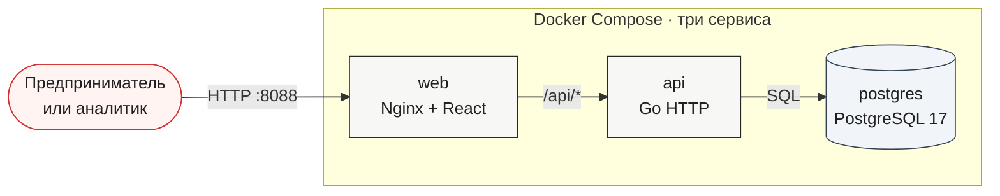
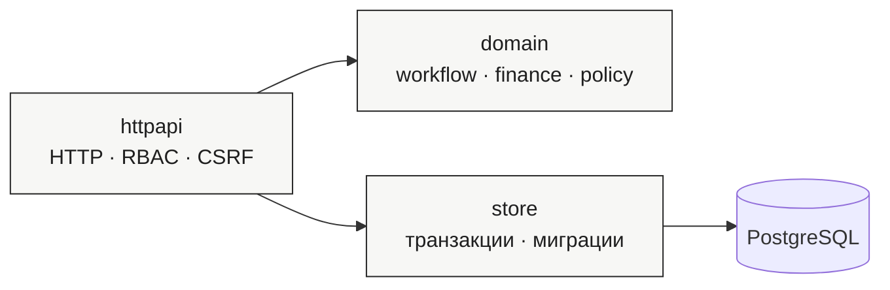
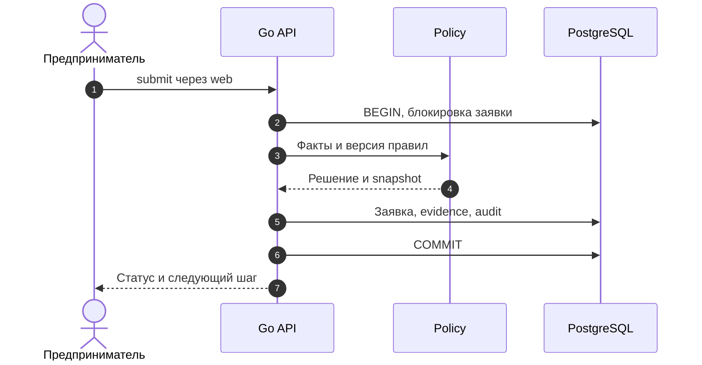

# Архитектура

ALFA FLOW — модульный монолит: React/TypeScript/Vite на web-слое, Go HTTP API и
PostgreSQL. В демонстрационном запуске это три контейнера Compose. Отдельные Kafka,
Redis, очереди и микросервисы не нужны: одна заявка изменяется синхронно в одной
транзакции, а UI получает новые статусы polling-запросами.

## Схема компонентов

**Как читать стрелки:**

- браузер видит только web на `localhost:8088`;
- Nginx отдаёт статические React-файлы и пересылает `/api/*` в Go API;
- API вызывает доменную политику и repository внутри одной транзакции;
- PostgreSQL хранит текущее состояние заявки и исторические evidence-записи;
- миграции и seed выполняются при старте API, поэтому отдельная команда для БД не нужна.

## Внутри Go API

Это **модули одного процесса**, а не дополнительные сервисы:

`httpapi` координирует доменные вычисления и repository. Чистый `domain` не обращается
к БД. `store` сохраняет результат транзакционно.

## Сквозной запрос заявки

Submission, accept и simulated signing — транзакционные mutations. `SELECT FOR UPDATE`
сериализует параллельные изменения одной заявки. `version` защищает от устаревшей
карточки, а `Idempotency-Key` делает повтор того же действия безопасным: тот же ключ
возвращает сохранённый ответ, а другой body с тем же ключом получает `409`.

## Где находится бизнес-логика

| Слой | Ответственность | Главные файлы |
|---|---|---|
| `domain` | модели, финансы, прогноз, policy, переходы статусов | `backend/internal/domain` |
| `httpapi` | HTTP-контракт, сессии, RBAC, CSRF, orchestration | `backend/internal/httpapi` |
| `store` | PostgreSQL, миграции, транзакции, immutable evidence | `backend/internal/store` |
| `web` | кабинеты предпринимателя/банка, формы, polling, charts | `web/src` |

## Failure modes и ограничения демо

- ошибка БД откатывает транзакцию, не оставляя частичного решения;
- недоступный mock-БКИ приводит к `manual_review`, а не к молчаливому отказу;
- недостаток документов или оборота приводит к `needs_info`;
- неизвестный engine при replay приводит к `cannot_replay`;
- registry, БКИ, authority, signing и disbursement — явные mock/simulated adapters;
- LLM и платные внешние API не вызываются;
- HTTP имеет timeout и graceful shutdown, логи идут через `slog` с request ID.

Контракт API генерируется из Go-моделей командой `go run ./cmd/contracts`, а
`pnpm test:contract` проверяет OpenAPI и реальные ответы. Frontend дополнительно
проверяется TypeScript, unit-тестами и Playwright E2E.
