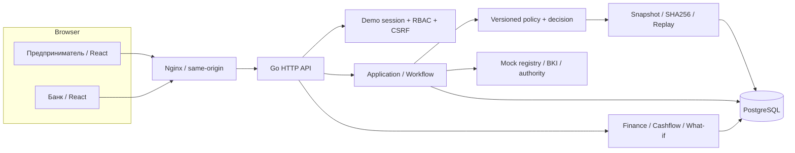

# Архитектура

Модульный монолит: Go stdlib HTTP, pgx, React/TypeScript/Vite, PostgreSQL 17.
Три контейнера; web проксирует `/api` на тот же origin. Модели / финансы / policy и workflow —
в `backend/internal/domain`, orchestration/RBAC — `httpapi`, транзакционный repository — `store`.
Не вводим Kafka/Redis/микросервисы, поскольку нет задачи, оправдывающей их стоимость.

Submission выполняется синхронно в одной DB-транзакции, создаёт событийный след каждого этапа.
Политика — чистая детерминированная функция. Уведомления/статусы читаются polling 2,5–3 с.
Отдельной очереди заданий и SSE нет: это осознанное упрощение, а не скрытая симуляция таймером.

`SELECT … FOR UPDATE` сериализует изменения заявки. Version сравнивается после idempotency lookup.
Ключ связан с actor, action, request body hash. Повтор того же действия возвращает сохранённый ответ,
изменение тела с тем же ключом — 409. Signing создаёт единственную DB-запись выдачи и событие.

Failure modes: при DB ошибке транзакция откатывается; недоступная mock БКИ → manual_review,
а не отказ; документ/оборот → needs_info; replay неизвестного engine → cannot_replay.
Сеансы также persist в PostgreSQL. HTTP timeout 20 с context; graceful shutdown; slog/request ID.
LLM/платные API отсутствуют, никакой деградации при выключенной модели нет.

Контракт: `go run ./cmd/contracts` создаёт OpenAPI из Go-моделей; `pnpm test:contract`
валидирует структуру спецификации и реальные ответы. Frontend types проверяются TypeScript и E2E.
