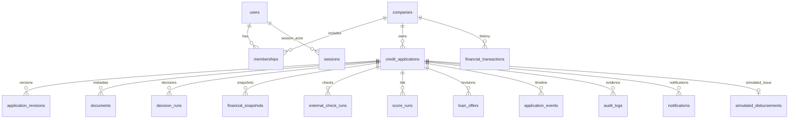

# Модель данных / schema v1 + v2 (CSV import)

Все деньги — RUB / int64 копейки, APR — basis points (2200 = 22%), UTC timestamptz.
UUID для доменных сущностей. Поля снимков сериализованы в JSONB; эта модель намеренно
сочетает aggregate application с нормализованными immutable evidence tables.

- `credit_applications`: PK id, FK company_id, status/version, JSONB aggregate, created/updated.
  Индексы `(company_id,created_at DESC)`, `(status,created_at DESC)`.
- `users`: уникальная persona; `memberships`: составной PK user/company; FK restrict по умолчанию.
- `sessions`: SHA256 bearer cookie, actor snapshot, expires_at. Открытый токен в БД не хранится.
- `loan_products`: text product code PK; `rule_sets`: составной PK id/version.
- `application_revisions`: PK application/version; новые исходные параметры при resubmit.
- `financial_transactions`: PK id/FK company, индекс по company; date/category/direction в JSONB.
- `financial_snapshots`: PK decision UUID string, исходные финансовые факты и embedded policy.
- `decision_runs`, `score_runs`, `external_check_runs`: PK id, FK application, JSONB evidence.
- `loan_offers`: PK id; unique application/revision; immutable. active/accepted pointers в aggregate.
- `application_events`, `audit_logs`, `notifications`: PK event id и FK application; совпадающий
  event ID позволяет сопоставить состояние, действие и аудит.
- `simulated_disbursements`: unique application, одна выдача на заявку.
- `idempotency_keys`: составной PK actor/action/key, request hash и сохранённый JSON response.
- `cashflow_imports`: UUID PK, company/actor FK, count/source SHA256/UTC; импорт не меняет старые decisions.

Snapshot, revisions, checks, scores, decisions, offers, events, audit имеют DB triggers,
запрещающие UPDATE/DELETE. INSERT ON CONFLICT DO NOTHING не переписывает исторические значения.
Обычное удаление по FK — RESTRICT; production каскадного удаления клиентской истории нет.
Отдельный dev-only admin reset использует TRUNCATE, доступный владельцу демо-БД: это
явное ограничение prototype trust model. Migration user и runtime user ещё не разделены.

Seed=2026: 20 компаний, стабильные фиктивные ID, `DEMO-ИНН-*` (не реальный ИНН),
без ФИО/номеров счетов. April–September 2026, категории sales/operations/rent/payroll/debt/
internal_transfer. F намеренно имеет один месяц. Имена и суммы сгенерированы локально,
не заимствованы из банковского датасета. Синтетический баланс — текущий остаток на дату модели,
а не начальный остаток истории. Уникальные ID исключают дубликаты при seed.
