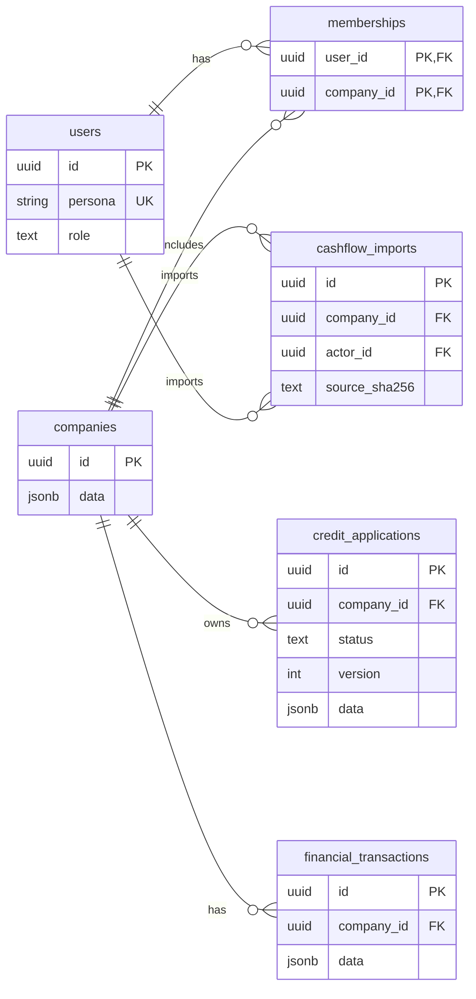
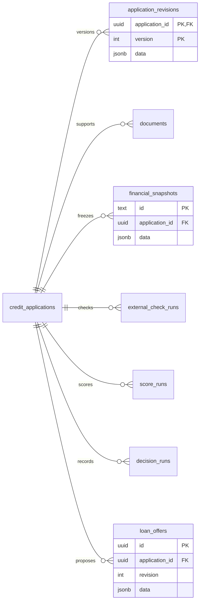
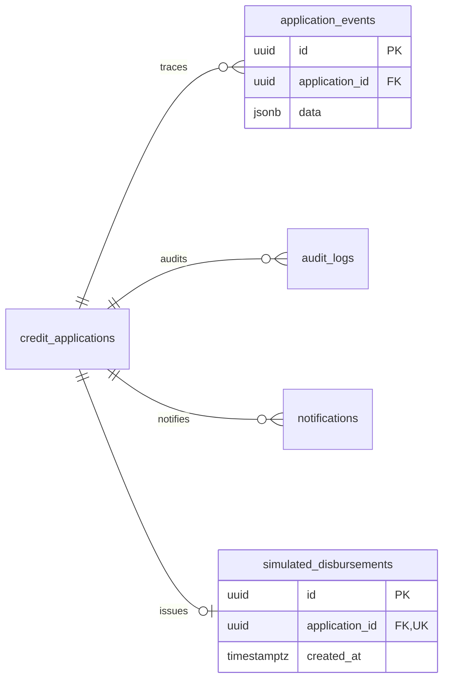
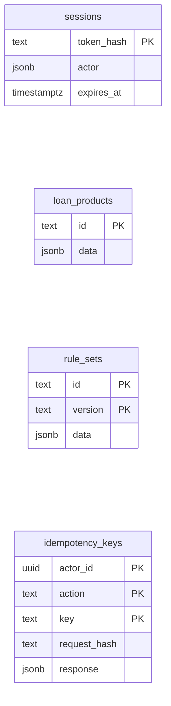

# Модель данных

Схема сочетает aggregate `credit_applications` с нормализованными историческими
таблицами. Деньги хранятся как `int64` копейки RUB, APR — basis points
(`2200 = 22%`), даты — `timestamptz` в UTC, доменные сущности — UUID.
Снимки решения и внешние ответы сохраняются в JSONB, чтобы replay видел исходные факты.

## 1. Компания, доступ и заявка

Здесь показаны реальные SQL-колонки. `data` — JSONB с бизнес-полями
(названием компании, параметрами заявки, фактами и т. п.), а не отдельные колонки.

**Легенда:** `PK` — первичный ключ, `FK` — внешний ключ, `UK` — уникальность;
`||--o{` — «один к нулю или многим», `||--o|` — «один к нулю или одному».
У `memberships` составной PK `(user_id, company_id)`.

## 2. Решение и условия

Каждая заявка может иметь много версий исходных данных, проверок и решений.
Повторное решение добавляет evidence, не изменяя предыдущий snapshot.

`loan_offers` имеет `UNIQUE(application_id, revision)`. У `documents`,
`external_check_runs`, `score_runs` и `decision_runs` одинаковый SQL-каркас:
`id UUID`, `application_id UUID`, `data JSONB`.

## 3. След действий и результат

Для `audit_logs` и `notifications` каркас такой же, как у `application_events`.
Один application ID может иметь только одну `simulated_disbursements` — это
дополнительная защита от повторной демо-выдачи.

## Вспомогательные таблицы

Они намеренно отделены от графа FK:

## Что хранится где

| Группа | Таблицы | Зачем |
|---|---|---|
| Identity | `users`, `memberships`, `sessions` | синтетическая persona, доступ к компании и cookie-сессии |
| Aggregate | `credit_applications` | текущий статус, версия, параметры и указатели active offer |
| Inputs | `application_revisions`, `documents`, `financial_transactions` | исходные данные, документы и история оборота |
| Decision evidence | `decision_runs`, `financial_snapshots`, `external_check_runs`, `score_runs` | объяснение результата и точные входные факты |
| Offer | `loan_offers` | неизменяемые версии условий, включая counteroffer |
| Timeline | `application_events`, `audit_logs`, `notifications` | события, аудит и сообщения внутри продукта |
| Output | `simulated_disbursements` | единственная запись демо-выдачи на заявку |
| Safety | `idempotency_keys` | повтор действия без повторного события или выдачи |
| Import | `cashflow_imports` | hash/метаданные CSV, не переписывает старые snapshots |

## Историчность и ограничения

`application_revisions`, snapshots, checks, scores, decisions, offers, events и audit
защищены DB-триггерами от `UPDATE`/`DELETE`. Новое решение добавляет новую запись,
а не переписывает прошлое. `INSERT ... ON CONFLICT DO NOTHING` используется для
идемпотентного seed и не изменяет исторические значения.

На схеме показаны реальные SQL FK; `sessions` содержит actor snapshot в JSONB,
а `idempotency_keys.actor_id` хранится без FK. `loan_products` и `rule_sets` — отдельные
каталоги, а не SQL-связь между собой. Параметры заявки
хранят выбранный product code, а decision snapshot фиксирует использованную версию policy.
Поля на диаграмме сокращены; источник истины —
[`schema.sql`](../backend/internal/store/schema.sql). Миграции 1 и 2 применяются
при старте API.

В seed `2026` — 20 синтетических компаний, стабильные demo ID и значения
`DEMO-ИНН-*`; реальных ФИО и номеров счетов нет. Период финансовой истории —
апрель–сентябрь 2026. Профиль F специально содержит только один месяц, чтобы
продукт честно перешёл в `needs_info`, а не придумал прогноз.

`docker compose down -v` удаляет volume целиком. Dev-only admin reset очищает
синтетические данные перечисленных таблиц через `TRUNCATE`, затем повторяет seed.
Это не production-механизм удаления истории; он доступен только после явного
подтверждения через UI/API. Migration user и runtime user в прототипе не разделены.
