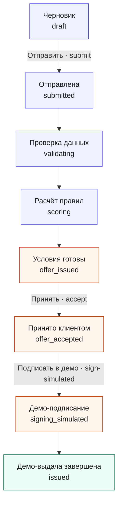
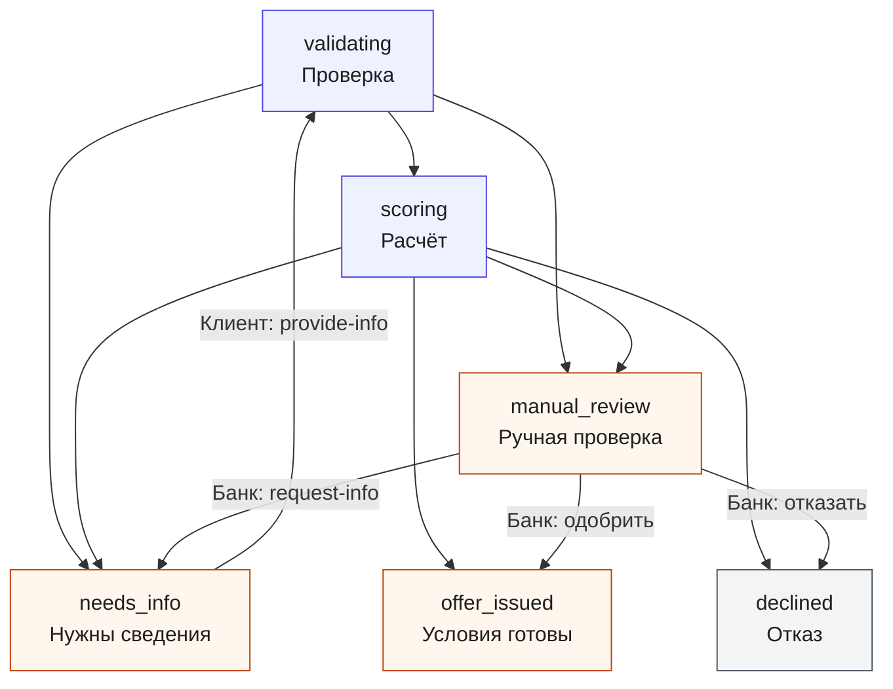

# Машина состояний заявки

Статус показывает, где заявка находится сейчас. Стрелка означает допустимый
переход после действия клиента, аналитика или системного pipeline. `counteroffer`
не является отдельным статусом: это `offer_issued` с типом предложения
`counteroffer`.

## Основной путь

**Как читать цвета:** синий — обычный pipeline, оранжевый — ожидание человека
или следующий шаг, зелёный — успешный финал, серый — terminal outcome.

`submitted`, `validating`, `scoring` фиксируются в timeline одной транзакции отправки.
`signing_simulated` и `issued` — в одной транзакции подписи: UI может сразу увидеть
итоговый статус, а не отдельный экран для каждого технического этапа.

## Если нужны сведения или решение аналитика

Переход `offer_issued → offer_issued` означает новую версию условий через
`request-offer`, а не вторую выдачу. Смена условий фиксируется отдельной версией
предложения и не переписывает предыдущую.

`draft → closed` и `offer_issued → closed` разрешены доменным графом, но **публичного
действия close и scheduler expiry в поставке нет**. Просроченное предложение
отклоняется при accept и не закрывается фоновым таймером.

## Действия и предусловия

| Action | Actor | Предусловие / эффект |
|---|---|---|
| save / documents | `client` | только своя компания; `draft` (документы также `needs_info`) |
| submit | `client` | `draft`, валидные сумма/срок/цель и consent; pipeline → outcome |
| provide-info | `client` | `needs_info`, открытый request; новая revision → pipeline |
| request-info | `bank_analyst` | `manual_review` или `needs_info`; открывает новый запрос |
| decide | `bank_analyst` | `manual_review`, основание не короче 8 символов |
| request-offer | `client` | `offer_issued`, условия допустимы по исходным фактам |
| accept | `client` | активное непросроченное предложение и consent |
| sign-simulated | `client` | `offer_accepted` и consent; создаёт demo issuance |
| replay | `bank_analyst` | исторический snapshot/engine; без mutation |

Все mutations требуют `version` и `Idempotency-Key`. Повтор того же действия не
добавляет событие или выдачу; конфликт версии возвращает `409`. UI читает server
status polling-запросами и не переводит заявку локальным `setTimeout`.

## Что специально запрещено

- `client` не может принять чужое или старое предложение;
- `draft`, `needs_info` и `declined` не перескакивают сразу в `issued`;
- клиент не выполняет банковское `decide`;
- истёкшее предложение не принимается;
- scheduler закрытия в прототипе не поставляется, поэтому `closed` доступен только
  в доменном графе для предусмотренных сценариев.
