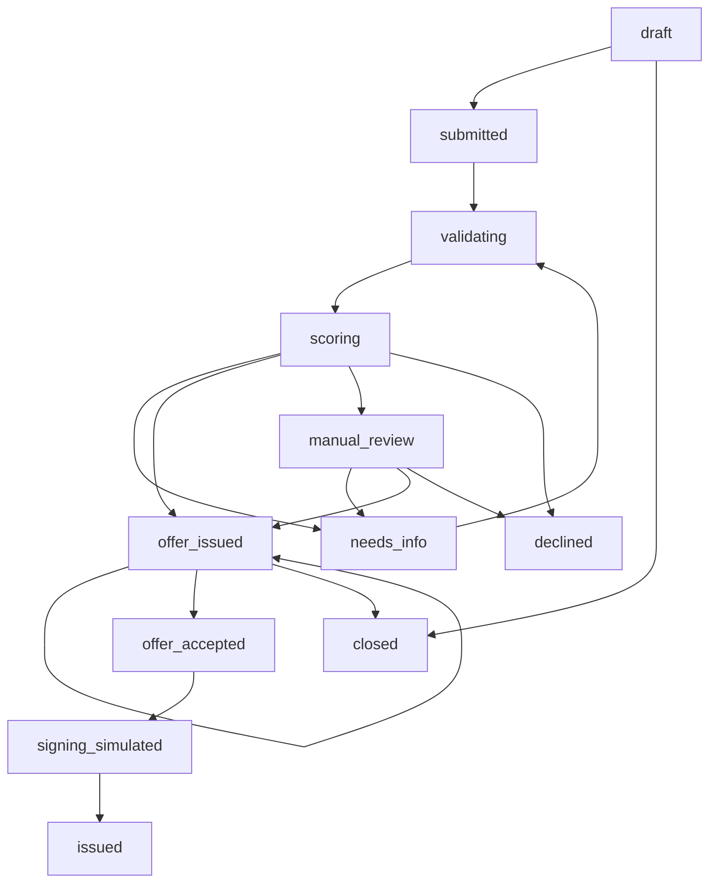

# Машина состояний

| Action | Actor | Предусловие / эффект |
|---|---|---|
| save / documents | client | только своей компании; draft (documents также needs_info) |
| submit | client | draft, валидные сумма/срок/цель, consent; pipeline → outcome |
| provide-info | client | needs_info, открытый request_id, ответ/consent; новая revision → pipeline |
| request-info | bank_analyst | manual_review либо needs_info; прежний запрос закрывается, новый открыт |
| decide | bank_analyst | manual_review, основание ≥8 символов, offer/decline |
| request-offer | client | offer_issued, amount/term/product допустимы по исходным финансовым фактам |
| accept | client | активное, непросроченное предложение, consent; offer_accepted |
| sign-simulated | client | offer_accepted, consent; system signing/issuance в той же транзакции |
| replay | bank_analyst | исторический snapshot/engine; без mutation |

Counteroffer — `offer_issued` + `offer.type=counteroffer`, не отдельный статус.
Нельзя draft/needs_info/declined → issued, client → bank decision, accept чужое/старое предложение.
Close/expiry присутствуют в доменном графе, но публичное действие закрытия не поставляется;
просроченное предложение отклоняется при accept, scheduler закрытия не реализован.

Все mutations требуют version и Idempotency-Key; одно действие = транзакция application +
revisions/decisions/offers/events/audit. Повторы не добавляют событий и выдач. Version conflict = 409.
UI читает server status polling, а не переводит его setTimeout.
